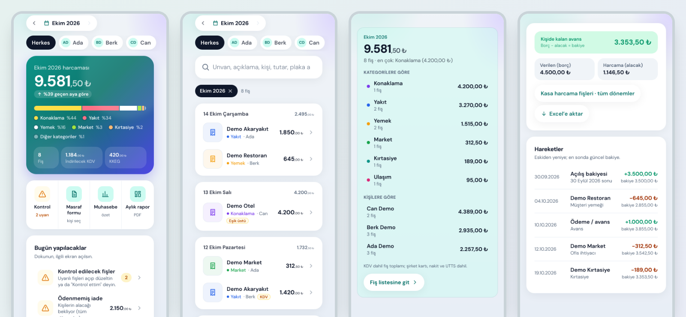

# FişAsistan: a receipt-checking web app (case study)

A web app where employees photograph expense receipts, a vision model reads them, the employee confirms, and a rules engine checks the numbers before the accountant sees them.

**Read the full case study: https://mkemalkahraman.github.io/fisasistan-case-study/**

## At a glance

- Web app that installs from the browser and runs on a phone home screen
- Next.js 16, React 19, TypeScript (strict), Supabase (Postgres, Storage), a Gemini vision model for reading receipts
- Every accounting rule is a row in a decision table, and every row has a test
- Money is stored as exact decimals; row-level security on every table; the secret key exists only on the server
- 580 automated tests, 18 real-browser scenarios, and the database migrations are tested on a real Postgres engine
- Every pull request is scanned for leaked secrets and unsafe CI settings
- A rule-based assistant (no language model) answers questions from figures the server calculates

## What it does

- **Upload:** photograph one receipt or several in a row; the model reads them and the employee confirms
- **Rules:** VAT sanity checks, duplicate detection and per-person rules, all defined in a decision table
- **Dashboard:** live monthly view, filters, a "Today" to-do card and a month-end checklist
- **Cash:** a running balance per person with a change history
- **Assistant:** ask questions in plain Turkish; answers come from server-calculated figures

## Lessons from real bugs

- **The mascot that jumped non-stop:** a "reduce motion" style left infinite animation loops running on one PC. Test on the slowest machine.
- **Reading got slow overnight:** a backup model request after 6 seconds, first answer wins. Design for a slow dependency.
- **VAT that did not add up:** the model split a two-rate receipt wrongly. Never trust a model's arithmetic; check the totals.
- **A date the model invented:** a faded date was read as a plausible wrong one. Add a check that does not depend on the model.

The full write-up is on the [case study page](https://mkemalkahraman.github.io/fisasistan-case-study/).

## About this repository

- **No source code is published here.** This is a case study only.
- **All screenshots use invented data.** Names, shops and amounts are made up for this page.
- The app's interface is in Turkish because it was built for a Turkish company. The labels are explained next to each screen.

## Credit

Built with Claude as a pair programmer. Product decisions, accounting rules and testing on real phones are mine.
